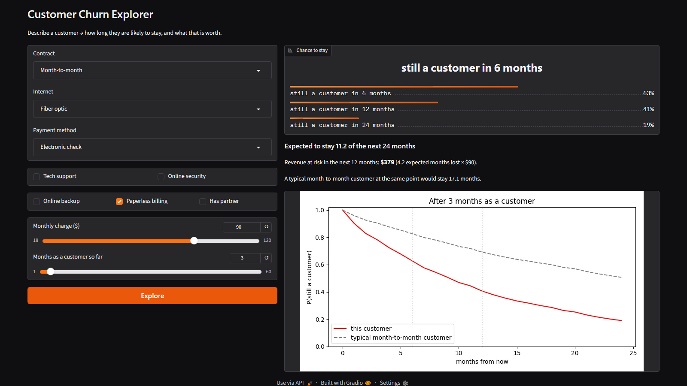
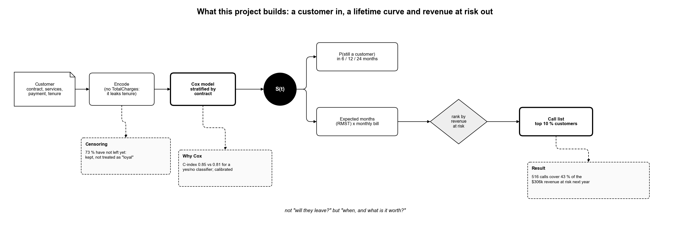
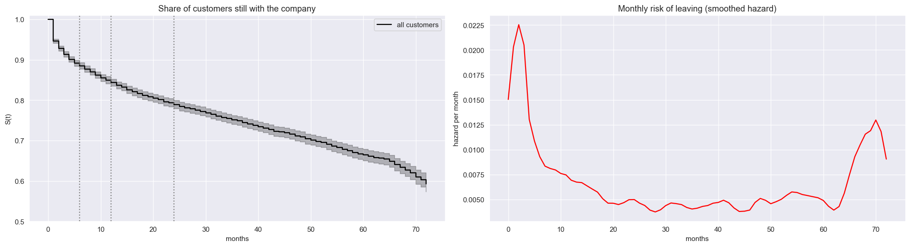
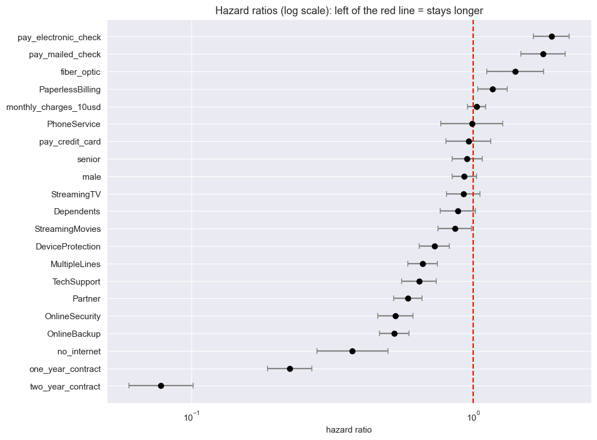
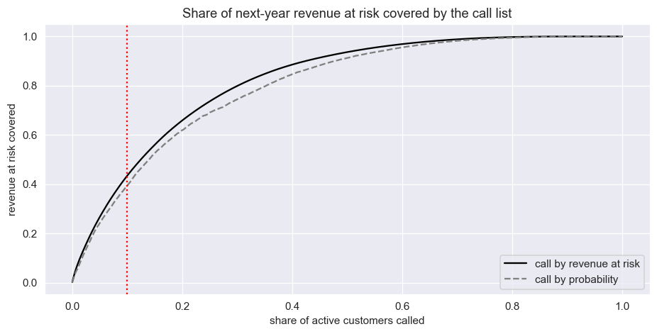
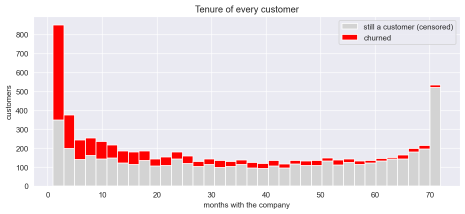
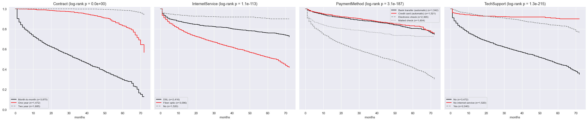
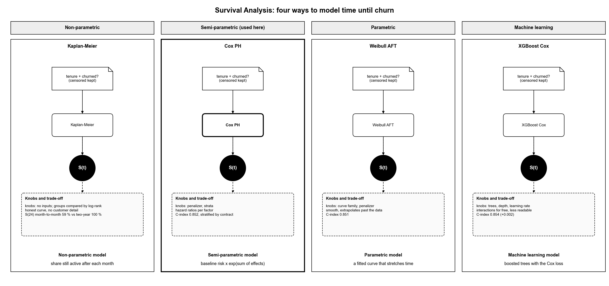
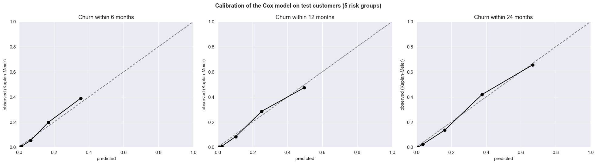
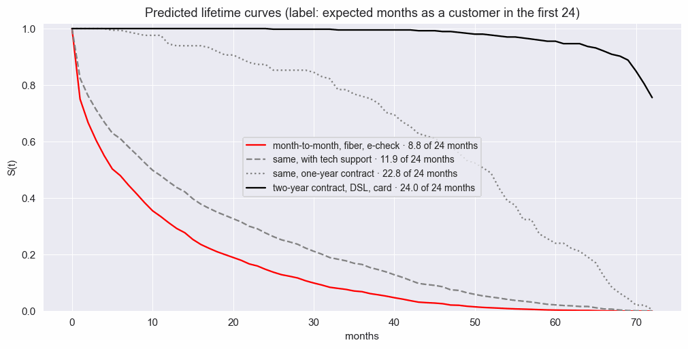

# Customer Churn with Survival Analysis: When Will a Customer Leave?

Survival analysis | Censoring | Kaplan-Meier | Log-rank test | Cox proportional hazards | Stratified Cox | Weibull AFT | XGBoost Cox | C-index | Calibration | RMST | Customer lifetime value | Gradio

## Objective

- **Problem** → a subscription business loses customers every month, and a yes/no churn model treats the 73 % who have not left *yet* as if they never will
- **Why this repo** → model *when* each customer is likely to leave (survival analysis), find what changes that timing, and turn each curve into expected months and revenue at risk
- **Real-world use** → a weekly retention call list ranked by money at stake, and a what-if view of contracts and support add-ons

## Highlights

**Question:** when do customers leave?

**Answer:** early. The risk of leaving is 1.5 % in the first month and falls to 0.4 % a month by month 36; 15.7 % of customers are gone within a year, yet 59 % are still there after six years. Averages hide this: churners stayed 18 months on average, which says nothing about the 73 % still active.

**Question:** what changes the risk, and by how much?

**Answer:** the contract dwarfs everything else, then payment method and support add-ons.

| Factor (Cox model, all else equal) | Hazard ratio | Meaning |
|---|---|---|
| Two-year contract (vs month-to-month) | **0.08** | 12× less risk |
| One-year contract | 0.22 | 4.5× less risk |
| Online backup / security / tech support | 0.52 / 0.53 / 0.64 | each cuts the risk by a third to a half |
| Fiber internet (vs DSL) | 1.41 | 41 % more risk |
| Paying by electronic check (vs bank transfer) | **1.89** | almost double the risk |

**Question:** who should the retention team call first, and what is it worth?

**Answer:** call by revenue at risk, not by probability. $305,872 of revenue is at risk over the next 12 months; calling the top 10 % (516 customers) by money covers 43.4 % of it, versus 39.3 % when ranked by churn probability.

| Same customer profile (month-to-month, fiber, e-check) | Expected months as a customer, next 24 |
|---|---|
| as is | 8.8 |
| + tech support | 11.9 |
| on a one-year contract | 22.8 |

## [1/7] Data

- **Dataset** → [Telco Customer Churn](https://www.kaggle.com/datasets/blastchar/telco-customer-churn) (IBM sample data) · 7,043 customers · not stored in this repository
- **Survival framing** → time = `tenure` (months), event = `Churn` = Yes; 73.4 % are still customers (censored)
- **Cleaning** → 11 customers with tenure 0 have no bill yet → dropped (7,032 kept)
- **Leak removed** → `TotalCharges` ≈ monthly charge × tenure (median ratio 1.000), so it would hand the model the duration it predicts

## [2/7] Run on Kaggle

- **Import** → Create → Import Notebook → upload `churn_survival_analysis.ipynb`
- **Input** → dataset `blastchar/telco-customer-churn` (default path `/kaggle/input/datasets/blastchar/telco-customer-churn`, searched under `/kaggle/input` if it moves)
- **Accelerator** → none (CPU, about 2 minutes)
- **Internet** → On: the first code cell runs `pip install lifelines` (not preinstalled on Kaggle)
- **Settings** → top cell; `SAVE_FIGURES`, `SAVE_MODEL`, `LAUNCH_APP` are all `False` → nothing is written, no app is started

## [3/7] Who stays longer?

- **Kaplan-Meier by group** → every gap is real (log-rank p < 1e-100)
- **Still a customer after 24 months** → month-to-month 58.6 % vs two-year 100 %; electronic check 62.4 % vs credit card 91.3 %; no tech support 65.3 % vs with support 91.7 %

## [4/7] Models

| Model (20 % test customers) | C-index | First-year customers |
|---|---|---|
| XGBoost Cox | 0.854 | 0.684 |
| Cox | 0.852 | 0.680 |
| Weibull AFT | 0.851 | 0.680 |
| Logistic yes/no classifier | 0.805 | 0.644 |
| Monthly charge alone | 0.508 | 0.560 |

- **Survival beats classification** → +0.05 C-index; the classifier mislabels new customers as "loyal" because they have not had time to leave
- **Boosting** → +0.002 over Cox, not worth losing the hazard ratios
- **Proportional hazards** → 5 factors change over time, led by the contract → the contract-stratified Cox keeps the ranking (0.852) and fixes long-tenure probabilities (month-to-month, month 60 → 72: 0.51 vs observed 0.57; plain Cox said 0.75)

## [5/7] Are the probabilities honest?

- predicted vs observed 12-month churn in 5 risk groups: 0.5 / 2 / 10 / 25 / 50 % vs 0 / 1 / 8 / 29 / 47 %

## [6/7] App

- **Run locally** → `pip install -r requirements.txt` → `python app.py`
- **Data** → `TELCO_CSV`, or `./data/`, or IBM's public copy is downloaded on first start (git-ignored); the stratified Cox model is rebuilt in a few seconds
- **Output** → chance to stay 6 / 12 / 24 months from now (given the months already stayed), expected months, revenue at risk, comparison with a typical customer on the same contract

## [7/7] Next steps

- **Uplift test** → the contract effect is an association; a randomised retention offer would measure what a call or a discount really changes
- **Time-varying data** → monthly usage, complaints and payment delays as time-dependent covariates
- **Profit-based list** → include the cost and success rate of a call to choose how many customers to call

| Path | Content |
|---|---|
| `churn_survival_analysis.ipynb` | full notebook (Kaggle-ready) |
| `app.py`, `requirements.txt` | Gradio churn explorer |
| `assets/` | figures and editable draw.io diagrams |
